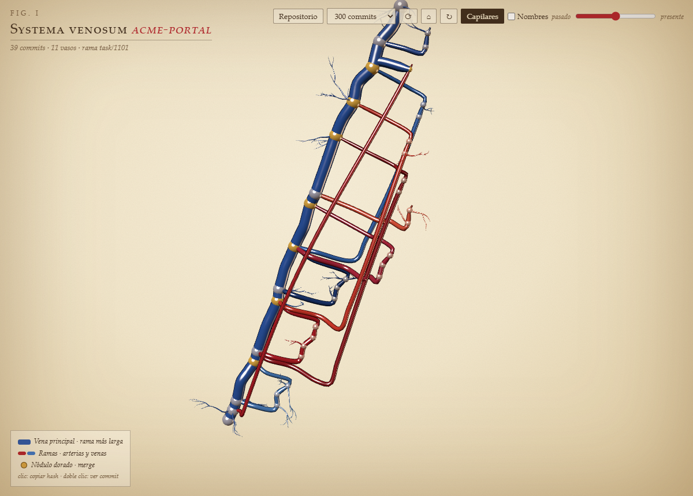
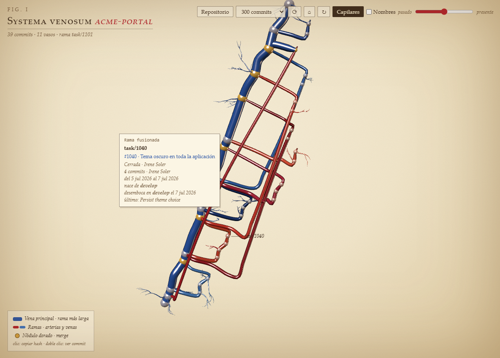
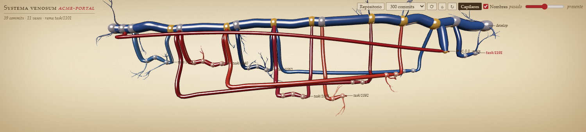

# Git Veins

**El historial de git de tu repositorio, dibujado como una lámina anatómica en 3D.** Cada rama es un vaso sanguíneo, cada commit un nódulo y cada merge una unión dorada. De un vistazo ves qué ramas siguen abiertas, de dónde salió cada una y cuándo volvió a su rama de origen.



## Qué hace

- **Grafo de git en 3D.** La rama principal (develop, master o main) es la vena gruesa, el resto de ramas son arterias y venas más finas, y los merges se ven como nódulos dorados.
- **Ficha de cada rama.** Al pasar el ratón por un vaso aparece su nombre, de qué rama nace y en cuál desemboca, sus commits, autores y fechas, y el último mensaje.
- **Integración con Redmine (opcional).** Si el nombre de la rama lleva un número de tarea (`task/1040`, `feature/1040-tema-oscuro`…), la ficha muestra el título, el estado y la persona asignada.
- **Vista limpia.** Los nombres de las ramas solo aparecen al pasar por encima. Si los quieres todos a la vista, marca la casilla **Nombres**.
- **Siempre al día.** Se redibuja sola cuando haces un commit, cambias de rama o haces fetch.
- **Se adapta al hueco.** En el panel inferior la historia se pinta en horizontal (pasado a la izquierda, presente a la derecha); en un hueco más alto, en diagonal como una lámina.





## Cómo se usa

1. Abre la pestaña **Git Veins** del panel inferior, o pulsa **❤ Venas** en la barra de estado.
2. Se carga el repositorio del fichero que tengas abierto. Con **Repositorio** eliges otro.
3. Usa estos controles:
   - **Arrastrar**: girar la lámina. **Rueda**: zoom. **Botón derecho**: desplazar.
   - **Deslizador pasado/presente**: recorrer la historia.
   - **Clic en un nódulo**: copia el hash del commit. **Doble clic**: abre el `git show` al lado.
   - **⌂** encuadra, **↻** activa el giro automático y **Capilares** muestra u oculta las ramificaciones decorativas.
   - El desplegable fija cuántos commits se cargan (de 150 a 1200).

## Configuración

La conexión con Redmine es opcional. Para activarla, crea el fichero `~/.claude/git-veins/config.json` con este contenido:

```json
{
  "redmineUrl": "https://redmine.tu-empresa.com",
  "redmineKey": "tu-clave-de-api"
}
```

La clave está en Redmine, en **Mi cuenta → Clave de acceso a la API**. Sin este fichero la ficha funciona igual, solo que sin el título de la tarea.

## Requisitos

- VS Code 1.85 o posterior.
- `git` instalado y en el PATH.

## Privacidad

Git Veins lee el historial con `git log` en tu máquina y no envía nada fuera. Solo hace llamadas a la red si configuras Redmine, y en ese caso únicamente consulta las tareas cuyas ramas miras, con tu propia clave.

## Comandos

| Comando | Qué hace |
| --- | --- |
| `Git Veins: abrir lámina del repositorio` | Abre la pestaña del panel. |
| `Git Veins: elegir repositorio` | Cambia el repositorio que se dibuja. |

---

Autor: **Alvaro Martos Diez** · Las capturas usan un repositorio de ejemplo con datos ficticios.
